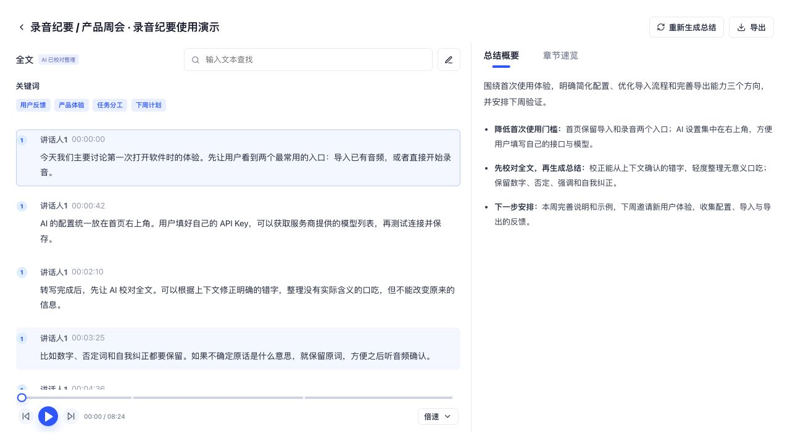
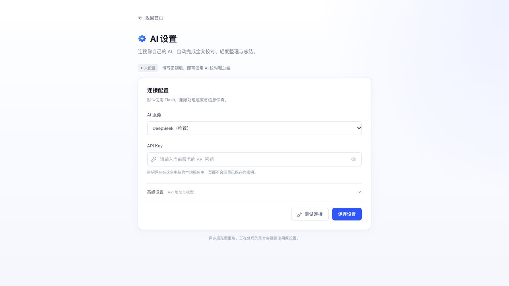

# AI 录音纪要

适用于苹果芯片 Mac 的本地录音纪要工具。中文/英文 Paraformer 快速转写，AI 结合上下文校对和轻度整理完整文字，再根据保存的完整成稿生成总结与章节。

## 产品预览

以下为基础功能的界面截图（演示内容；v0.2.0 另新增自动分人状态和重新分人按钮），文字为专门编写的演示数据；不含个人录音、历史笔记或 API 密钥。首次使用时笔记列表为空。

**导入音频，或直接开始录音。** 首页集中管理笔记，右上角进入 AI 设置。


**左侧读全文，右侧看重点。** 全文经 AI 校对和轻度整理后，再生成总结与章节；支持查找、编辑、回听定位和导出。



**使用自己的 AI 服务。** 填写密钥即可测试并保存；展开高级设置可修改 API 地址、获取可用模型列表或手动填写模型名称。



## 普通用户下载

到 [Releases](https://github.com/yaozitao709-del/ai-audio-notes/releases/latest) 选择一种 ZIP。不要把 GitHub 自动生成的 Source code ZIP 当作安装包。

| 下载 | 适合谁 | 首次启动 |
| --- | --- | --- |
| **AI-Audio-Notes-v0.3.0-lite-macos-arm64.zip**（约 0.9 MB） | 希望小体积下载，或已有 Python / Node / 模型环境 | 自动检测并复用兼容组件，只补齐缺少或版本不符的部分 |
| **AI-Audio-Notes-v0.3.0-full-macos-arm64.zip**（约 583 MB） | 希望自带已验证的推理环境，少处理依赖 | 已内置 Node、Python、Paraformer、VAD 和 CAM++；首次仍需联网准备音频工具 |

两版使用同一套转写和分人方法，完整版本会继续保留。**轻量版的小体积指启动包本身；完全没有环境的电脑，首次需要下载的总量仍可能接近完整版。**

1. 完整解压并保留整个文件夹。轻量版的文件夹名为 `AI-Audio-Notes-Lite`，完整版为 `AI-Audio-Notes`；放在同一目录时，轻量版也会检测完整版可复用的组件。
2. 双击 **启动AI录音纪要.command**。轻量版会显示检测、复用和补装进度；缺少组件时需要联网，不要求自行安装 Homebrew、Node 或 Python。
3. 网络中断后重新启动即可；已经校验通过的文件不会重复下载，未完成的下载会尝试续传。
4. 浏览器打开后，点右上角 **AI 设置**，填写自己的 API Key。默认 DeepSeek Flash，也支持兼容服务和自定义模型。
5. 双击 **关闭AI录音纪要.command** 停止后台。升级前先关闭旧版；原笔记保存在同一个 Application Support 目录中。

### 轻量版如何复用环境

- 自动检查 PATH、当前激活的 venv/Conda、常见 Homebrew/pyenv/Conda 位置、同目录或常见安装位置的完整版。
- Node 需为 Apple Silicon 原生版本且版本不低于 26。Python 使用已验证的 **3.11 / arm64** 配置；依赖按 `requirements-speech.txt` 检测，并验证关键模块能加载。版本不符时只在应用自己的隔离环境中补装，不升级或卸载原环境。
- 模型逐文件校验 SHA256；已有匹配文件会直接复用，不重新下载。音频工具还会检查常用录音格式支持。
- 缺少的环境和模型放在 `~/Library/Application Support/AI Audio Notes/runtime-cache`。复用的外部环境被移动或卸载后，下一次启动会重新检测和补齐。
- 自定义环境可通过 `SPEAKER_PYTHON` 指定 Python，通过 `AI_AUDIO_REUSE_DIRS` 指定其他应用目录（多个目录用冒号分隔），通过 `PARAFORMER_MODEL_DIR` / `SPEAKER_MODEL_ROOT` 指定模型位置。只检测这些明确位置和常见位置，不扫描整块磁盘。
- `AI_AUDIO_NODE` 可指定 Node；`AI_AUDIO_CACHE_DIR` 可改变运行缓存位置。通常不需要设置这些参数。

此包需要 **M 系列苹果芯片 Mac、macOS 14 Sonoma 或更新版本**；不包含 Intel Mac、Windows、Linux 运行包。它是脚本启动包，不是经过 Apple 签名公证的 DMG。macOS 首次询问是否打开时，请检查下载来源并使用系统提供的正常打开方式；不要关闭系统安全保护。

## 数据与隐私

- 包内 **不含任何个人 API 密钥、录音、历史转写、总结、专名词表或开发日志**。首次打开应是空白笔记和未配置 AI 状态。
- 数据保存在自己的 `~/Library/Application Support/AI Audio Notes`。升级前先关闭旧版，重新下载时保留此目录即可；不要把它转发给别人。
- 语音识别在本机完成，原音不会被本应用上传到 AI 服务。**校对与总结会把文字发送给用户自行配置的 AI 服务**，并遵循该服务的规则和费用。
- API Key 保存在本机配置文件中，文件权限限制为当前用户；页面不回显完整旧密钥。分享应用时不要附带本机数据目录或 `.env`。
- 新导入自动区分讲话人；新录音在结束后完成分人。历史记录可点“重新区分讲话人”，处理前自动备份。编号表示录音内的声音身份，不是真实姓名。
- v0.2.0 修复了少量异常声音导致两位主要讲话人被合并的问题；长录音使用谱聚类，苹果芯片优先使用 MPS/GPU，失败时回退 CPU。
- 时间为声音片段定位参考，不是逐字对齐；短促插话、重叠讲话、相似声音仍可能误分。
- 整理保留强调、犹豫、数字、否定与自我纠正，无法确定的地方可能继续保留原词；不保证消除所有识别错误。

## 开发者运行源码

请从 GitHub 克隆源码后开发，不要直接修改分发包中的合并文件。需要苹果芯片 Mac、Node.js 26+ 和 Python 3.11：

```sh
npm ci
npm run setup:models
npm run setup:speakers
python3.11 -m venv .venv
.venv/bin/python -m pip install -r requirements-speech.txt
export SPEAKER_PYTHON="$PWD/.venv/bin/python"
npm run build
npm start
```

源码仓库不存放大型模型及 Node/Python 运行时。模型下载会校验 `MODEL_MANIFEST.json` 和 `SPEAKER_MODEL_MANIFEST.json` 的 SHA256。`npm start` 使用现有运行依赖，不会修改全局 Node 配置。开发页面可分别运行 `npm run server` 和 `npm run dev`。

```sh
# 完整测试需要上游公开测试音频（不是个人录音）
node scripts/download-models.mjs --test
node scripts/download-speaker-models.mjs --test
npm test
npm run test:asr
npm run test:installer
npm run build
```

`PORT`、`AI_AUDIO_DATA_ROOT`、`PARAFORMER_MODEL_DIR`、`SPEAKER_PYTHON`、`SPEAKER_MODEL_ROOT` 可选；源码开发可用 `SPEAKER_DIARIZATION=false` 关闭分人以运行纯快速转写。端口被其他程序占用时启动器会提示，不会打开或停止其他程序。保存 AI 配置后新任务立即使用；已开始的录音继续使用原配置。

## 许可与来源

应用代码采用 MIT，模型及第三方组件保留各自许可证，见 [THIRD_PARTY_NOTICES.md](THIRD_PARTY_NOTICES.md)。Paraformer 模型来源于 [sherpa-onnx 的中英双语模型](https://huggingface.co/csukuangfj/sherpa-onnx-streaming-paraformer-bilingual-zh-en)，按其模型卡声明为 Apache-2.0。
